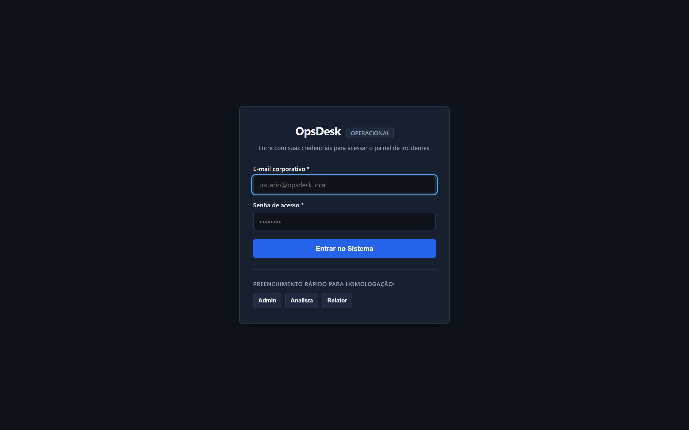
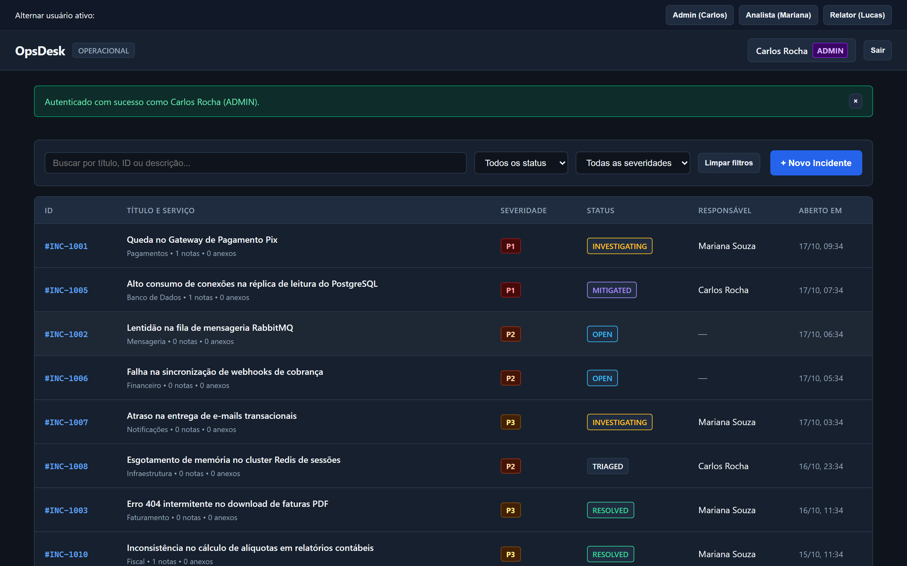
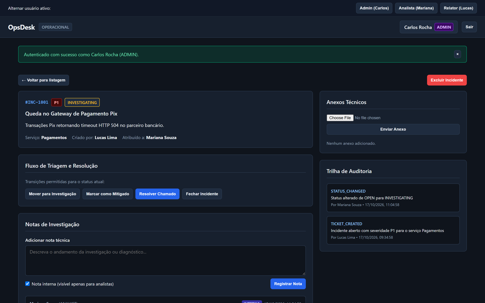
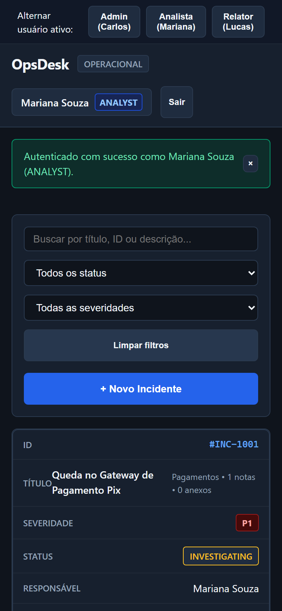
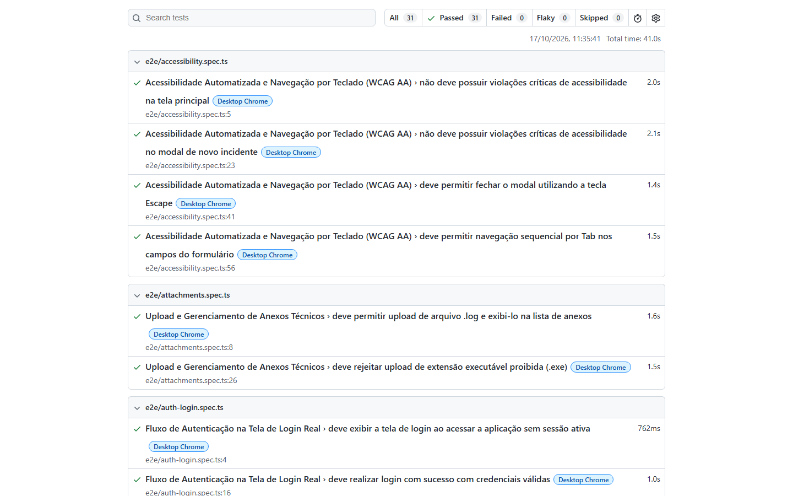

# OpsDesk

Painel de chamados técnicos e suíte de testes automatizados com Playwright, TypeScript, Axe-core e K6.

O projeto tem dois componentes: uma aplicação web funcional com backend em Fastify e banco SQLite nativo (`node:sqlite`), e uma suíte de testes cobrindo fluxos ponta a ponta, contratos de API, acessibilidade e carga.

---

## Telas do Sistema

### 1. Tela de Login
Tela com autenticação via token JWT e botões de preenchimento rápido para cada perfil.



### 2. Painel Operacional de Incidentes
Listagem com 10 chamados iniciais, filtros por severidade (P1 a P4), status e campo de busca textual em tempo real.



### 3. Detalhes do Incidente, Notas e Auditoria
Visualização completa do chamado `#INC-1001` com notas técnicas (públicas e internas), anexos e trilha de auditoria de cada ação.



### 4. Visualização em Dispositivos Móveis
Layout responsivo adaptado para telas pequenas, com tabela convertida em cards verticais e botões com área de toque mínima de 44px.



### 5. Relatório de Execução dos Testes (Playwright)
Todos os 31 testes passando em 40 segundos, cobrindo fluxos de login, máquina de estados, permissões, uploads, acessibilidade e API REST.



---

## Contas de Teste (Login)

O sistema possui três níveis de acesso configurados no banco:

| Cargo | Nome | E-mail | Senha | O que pode fazer |
| :--- | :--- | :--- | :--- | :--- |
| **Administrador** | Carlos Rocha | `admin@opsdesk.local` | `Admin123!` | Acesso total. Pode excluir chamados e alterar qualquer status. |
| **Analista** | Mariana Souza | `analyst@opsdesk.local` | `Analyst123!` | Assume chamados, adiciona notas internas e resolve incidentes. |
| **Relator** | Lucas Lima | `reporter@opsdesk.local` | `Reporter123!` | Abre novos chamados. Não vê notas internas nem botão de exclusão. |

Na tela de login há botões para preencher essas credenciais com um clique.

---

## Regras da Aplicação

1. **Permissões por Perfil (RBAC)**: o Relator só visualiza notas públicas e não tem acesso a botões de exclusão ou transição de status. O Analista pode marcar notas como internas. O Administrador pode deletar chamados.
2. **Ciclo de Vida do Incidente**:
   - `OPEN` (Aberto) &rarr; `TRIAGED` (Triado) &rarr; `INVESTIGATING` (Em investigação) &rarr; `MITIGATED` (Mitigado) &rarr; `RESOLVED` (Resolvido) &rarr; `CLOSED` (Fechado).
   - O sistema bloqueia a mudança direta de `OPEN` para `CLOSED`.
   - Mudar para `RESOLVED` exige o preenchimento de uma nota com a causa raiz e a solução aplicada.
3. **Upload de Anexos**: aceita arquivos `.log`, `.txt`, `.pdf`, `.png` e `.jpg` de até 10 MB. Arquivos executáveis como `.exe` são rejeitados com erro 400.
4. **Trilha de Auditoria**: toda criação, mudança de status, inclusão de nota ou anexo gera um registro imutável com data e autor.
5. **Acessibilidade**: navegação por teclado funcional (tecla Tab nos formulários e Escape para fechar modais), com contraste verificado no padrão WCAG 2.1 AA.

---

## O Que a Suíte de Testes Cobre

A suíte conta com 31 testes automatizados divididos em:

- `tests/e2e/auth-login.spec.ts`: visualização da tela de login, autenticação com sucesso, rejeição de senha inválida, preenchimento rápido e logout.
- `tests/e2e/auth-rbac.spec.ts`: visibilidade de botões por perfil, bloqueio de notas internas para o relator e ações do analista.
- `tests/e2e/ticket-lifecycle.spec.ts`: abertura de chamados, bloqueio de fechamento direto e fluxo completo de resolução com nota obrigatória.
- `tests/e2e/attachments.spec.ts`: envio de arquivo `.log`, recusa de arquivo `.exe` e exclusão de anexos.
- `tests/e2e/filters-search.spec.ts`: filtros por severidade, busca em tempo real, estado vazio e restauração da lista.
- `tests/e2e/accessibility.spec.ts`: varredura com Axe-core na tela principal e nos modais, além de testes com teclado.
- `tests/e2e/mobile-responsive.spec.ts`: verificação de overflow horizontal e tamanho de botões em viewport de celular (Pixel 7).
- `tests/api/tickets-api.spec.ts`: validação de schemas de resposta com Zod, códigos HTTP (401, 403, 422) e prevenção contra SQL Injection.

A fixture de teste executa um reset automático do banco de dados antes de cada teste (`POST /api/test/reset`), garantindo que um teste não interfira nos dados do outro.

---

## Como Rodar o Projeto

### Pré-requisitos
- Node.js 22 ou superior.
- NPM 10 ou superior.

### 1. Instalação
```bash
git clone <url-do-repositorio>
cd PROJ1
npm install
npx playwright install chromium
```

### 2. Iniciar a Aplicação
```bash
npm start
```
Abra `http://localhost:3000` no navegador.

### 3. Rodar os Testes Automatizados
```bash
# Executa todos os testes (E2E, API e Acessibilidade)
npm test

# Executa apenas os testes de contrato de API
npm run test:api

# Executa os testes abrindo a interface do Playwright
npm run test:ui

# Abre o relatório HTML detalhado da última execução
npm run test:report
```

---

## Testes de Carga com K6

Os scripts ficam na pasta `tests/k6/`:

```bash
# Teste de fumaça: 1 usuário virtual por 30 segundos
k6 run tests/k6/smoke-test.js

# Teste de carga: rampa de até 30 usuários virtuais concorrentes
k6 run tests/k6/load-test.js
```

Critérios definidos nos scripts:
- 95% das requisições devem responder em menos de 300ms.
- Taxa de erros menor que 1%.

---

## Estrutura de Pastas

```text
├── .github/workflows/test-e2e.yml  # Pipeline de CI no GitHub Actions
├── app/
│   └── src/
│       ├── client/                 # Interface web (HTML5, CSS, JS)
│       ├── server/                 # Servidor Fastify, rotas e SQLite
│       └── shared/                 # Tipos e schemas Zod
├── docs/screenshots/               # Imagens das telas e relatórios
├── scripts/capture-screenshots.ts  # Script Playwright para capturar as telas
├── tests/
│   ├── api/                        # Testes de contrato de API REST
│   ├── e2e/                        # Testes ponta a ponta e acessibilidade
│   ├── factories/                  # Geração de dados de teste
│   ├── fixtures/                   # Fixtures do Playwright e reset de banco
│   ├── k6/                         # Scripts de teste de carga
│   └── pages/                      # Page Objects (POM)
├── DESIGN.md                       # Especificação visual e tokens de cor
├── PLAN.md                         # Planejamento inicial
└── playwright.config.ts            # Configuração do Playwright
```
